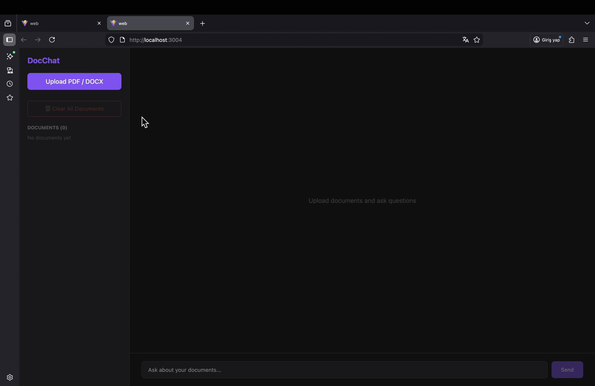

# DocChat — RAG Document Assistant

Ask questions about your own PDF and DOCX files and get answers grounded in the documents, with the source passages cited.



---

## How it works

```
Upload ──► load (PyPDF / docx2txt) ──► split into 1,000-char chunks (200 overlap)
       ──► embed ──► ChromaDB (persisted to disk)

Question ──► embed ──► top-4 similar chunks ──► grounding prompt ──► LLM ──► answer + sources
```

The prompt tells the model to answer only from the retrieved context, and every response returns the source files of the chunks it used.

## Features

- Upload PDF and DOCX files; chunks are stored in a persistent ChromaDB collection.
- Semantic retrieval (top-4 chunks) with source citations in each answer.
- Swappable models behind one API:
  - Embeddings: OpenAI `text-embedding-3-large` or Hugging Face `all-MiniLM-L6-v2`
  - LLMs: OpenAI `gpt-4o-mini` or a local Llama 3 through Ollama
- Async FastAPI endpoints and a React chat UI.

## API

| Method | Endpoint | Purpose |
|---|---|---|
| `POST` | `/upload` | Upload a PDF/DOCX file, chunk it, and index it |
| `POST` | `/query` | Ask a question; returns the answer and its sources |
| `GET` | `/documents` | List indexed documents |
| `POST` | `/clear` | Remove all documents and reset the vector store |

## Tech stack

| Layer | Technology |
|---|---|
| Backend | Python, FastAPI, LangChain |
| Vector store | ChromaDB |
| Models | OpenAI, Hugging Face sentence-transformers, Ollama (Llama 3) |
| Frontend | React 19, Vite, Axios |
| Packaging | Docker, Docker Compose, nginx |

## Getting started

### Option 1: Docker (one command)

Requires [Docker Desktop](https://www.docker.com/products/docker-desktop/).

```bash
git clone https://github.com/melihbed/docchat-rag-assistant.git
cd docchat-rag-assistant
cp .env.example .env            # add your OPENAI_API_KEY
docker compose up --build       # open http://localhost:3004
```

The stack runs two containers: the FastAPI backend and an nginx container that serves the React build and proxies `/api` to the backend. The vector store, uploaded files, and the embedding-model cache live in named volumes, so they survive restarts.

### Option 2: Run locally

**Backend**

```bash
cd api
python -m venv .venv && source .venv/bin/activate
pip install -r requirements.txt
export OPENAI_API_KEY=sk-...
uvicorn main:app --reload       # http://localhost:8000
```

**Frontend**

```bash
cd web
npm install
npm run dev                     # http://localhost:3004 (proxies /api to :8000)
```

## Roadmap

- Conversation memory for follow-up questions
- Retrieval evaluation set (hit rate and answer faithfulness)
